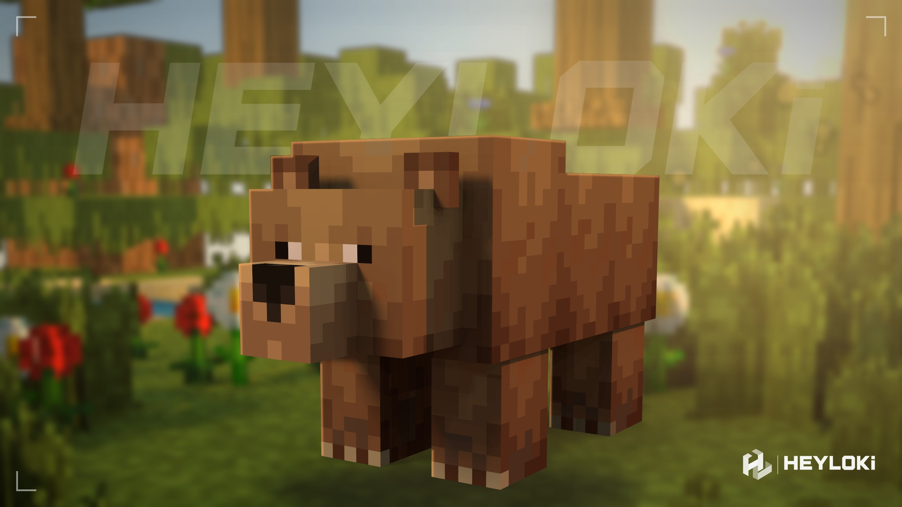
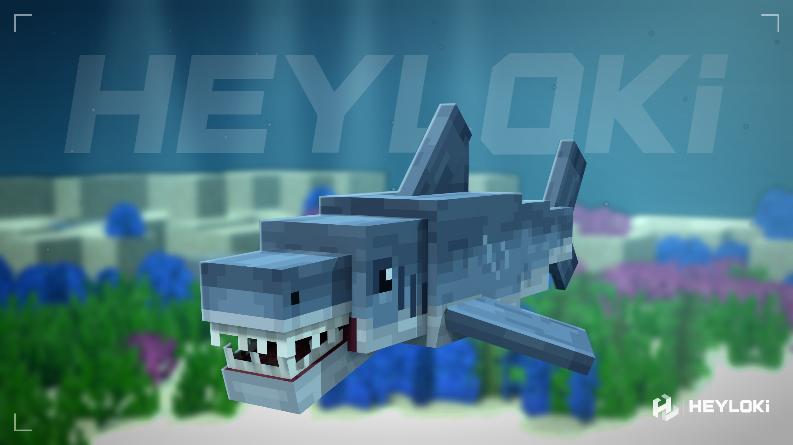

  <picture>
    <source media="(prefers-color-scheme: dark)" srcset="assets/logo-dark.png">
    
  </picture>

<h1 align="center">Model Gallery</h1>

Minecraft Bedrock models, textures and animations.

 

<table align="center">
  <tr>
    <td align="center" width="33%" valign="top"> <h3 align="center">Brown Bear</h3>  </td>
    <td align="center" width="33%" valign="top"> <h3 align="center">Reef Shark</h3>  </td>
  </tr>
</table>

 

© HeyLoki

