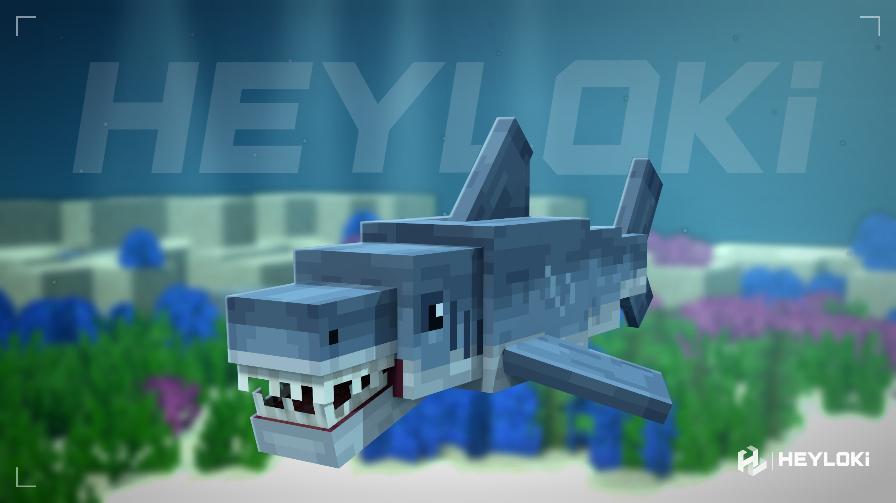
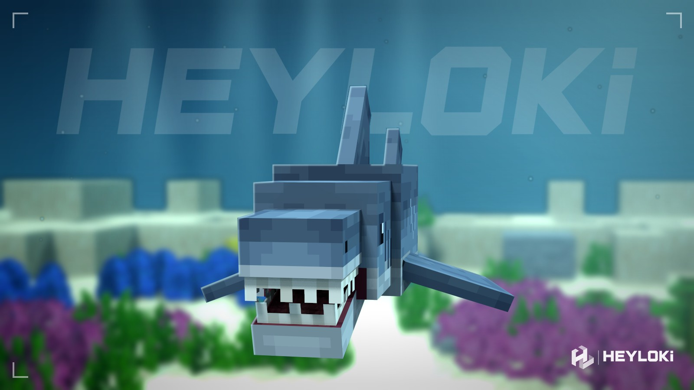
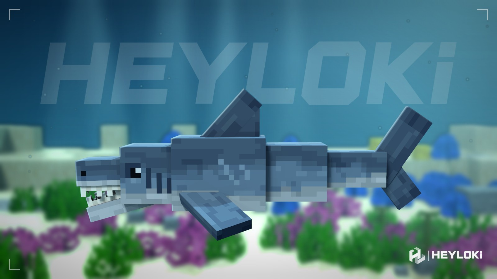
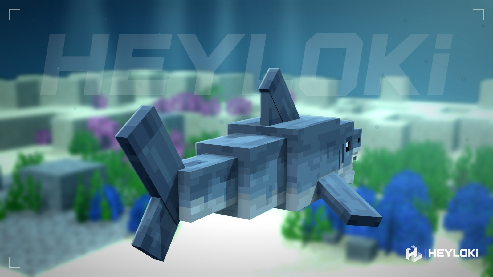
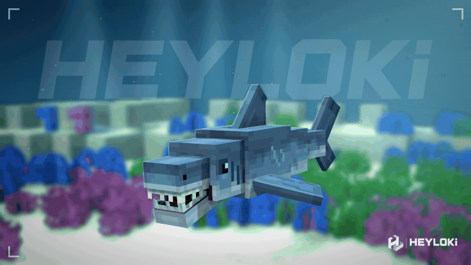
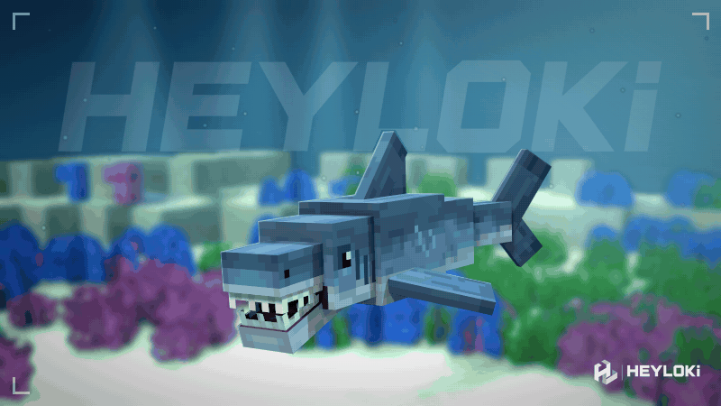
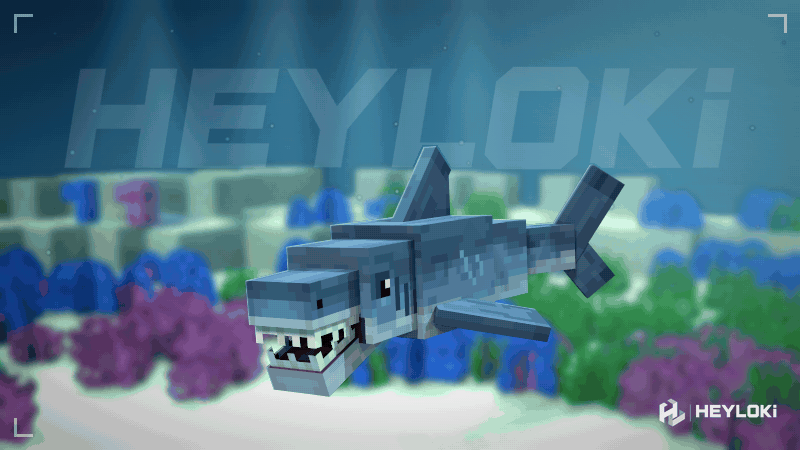
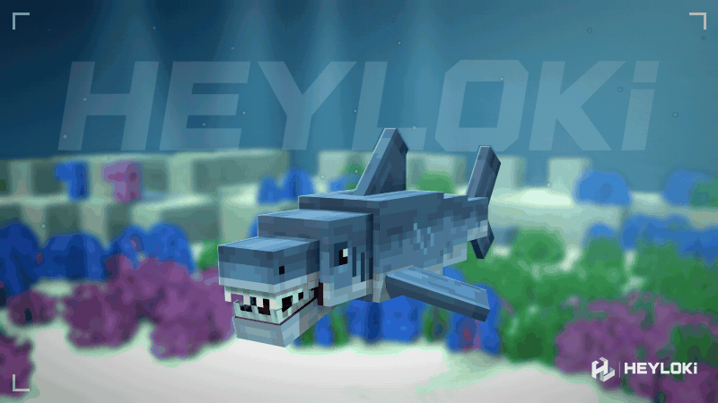

<h1 align="center">Reef Shark</h1>

## Renders

<table>
  <tr>
    <td align="center" width="33%"> <b>Front</b></td>
    <td align="center" width="33%"> <b>Side</b></td>
    <td align="center" width="33%"> <b>Back</b></td>
  </tr>
</table>

## Animations

<table>
  <tr>
    <td align="center" width="33%"> <b>Idle</b></td>
    <td align="center" width="33%"> <b>Swim</b></td>
    <td align="center" width="33%"> <b>Sprint</b></td>
  </tr>
  <tr>
    <td align="center" width="33%"> <b>Bite</b></td>
    <td align="center" width="33%"> <b>Hurt</b></td>
    <td align="center" width="33%"> <b>Death</b></td>
  </tr>
</table>

## Specifications

<table>
  <tr>
    <td width="33%" valign="top">MODEL <b>Reef Shark</b></td>
    <td width="33%" valign="top">CATEGORY <b>Aquatic Creature</b></td>
    <td width="33%" valign="top">PLATFORM <b>Minecraft Bedrock</b></td>
  </tr>
  <tr>
    <td width="33%" valign="top">ELEMENTS <b>14</b></td>
    <td width="33%" valign="top">BONES <b>9</b></td>
    <td width="33%" valign="top">TEXTURE DENSITY <b>16x</b></td>
  </tr>
  <tr>
    <td colspan="2" width="67%" valign="top">ANIMATIONS <b>6 (Idle, Swim, Sprint, Bite, Hurt, Death)</b></td>
    <td width="33%" valign="top">DIMENSIONS <b>2.39 × 1.67 × 4.41 blocks (W × H × L)</b></td>
  </tr>
  <tr><td colspan="3"></td></tr>
</table>

 

